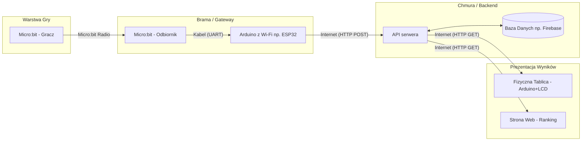

# Sem5_JIPP
Projekt zręcznościowej gry sprzętowej opartej na platformie Micro:bit, wyposażonej w system zapisywania wyników i globalny ranking.

## Architektura

## Przepływ danych

Logika samej gry jest w całości zaimplementowana na mikrokontrolerze **Micro:bit**. Ze względu na brak wbudowanego modułu Wi-Fi, komunikacja ze światem zewnętrznym wymaga urządzeń pośredniczących.

* **Micro:bit (gra)** po zakończeniu rozgrywki wysyła wynik gracza bezprzewodowo, wykorzystując wbudowany protokół **Micro:bit Radio**.
* Paczkę danych przechwytuje drugi **Micro:bit (odbiornik)**.
* Odbiornik jest połączony kablem z mikrokontrolerem **Arduino** (wyposażonym w moduł Wi-Fi, np. ESP32). Komunikacja między nimi odbywa się przez interfejs szeregowy (**UART**).
* **Arduino** pełni tu wyłącznie rolę bramy sieciowej (gateway) – odbiera ramkę danych z UART, pakuje ją w format JSON i wysyła przez Wi-Fi do serwera.

## Backend i Baza Danych

Rolę backendu pełni serwer API (np. napisany w środowisku **Node.js**). API wystawia proste endpointy RESTowe:

* `POST /api/scores` – do przyjmowania nowych wyników z bramki sieciowej Arduino.
* `GET /api/ranking` – do pobierania aktualnego zestawienia najlepszych graczy.

Jako bazę danych wykorzystamy usługę chmurową **Firebase** (Realtime Database lub Firestore). Jest to nierelacyjna baza danych (NoSQL), która pozwala na szybki zapis dokumentów z ID gracza oraz wynikiem, a także umożliwia łatwe sortowanie tabeli liderów.

## Prezentacja rankingu

Ranking jest prezentowany na dwa sposoby:

1. **Webowo:** Lekka aplikacja frontendowa uruchamiana w przeglądarce, wyświetlająca posortowaną tabelę wyników pobraną z API.
2. **Fizycznie (Hardware):** Osobny moduł składający się z **Arduino i wyświetlacza LCD**. Mikrokontroler ten cyklicznie wykonuje zapytanie `GET` do serwera, a pobrane dane o najlepszych graczach renderuje bezpośrednio na fizycznym ekranie przy stanowisku gry.

## Środowisko uruchomieniowe i Wirtualizacja

Aby ułatwić wdrożenie i odizolować aplikację, API backendowe zostanie skonteneryzowane przy użyciu **Dockera**. Konfiguracja zostanie opisana w pliku `docker-compose.yml`, co pozwoli na szybkie postawienie środowiska na serwerze VPS (np. AWS lub Azure).

Aplikacja webowa prezentująca ranking może zostać wdrożona na darmowych platformach hostingowych dla statycznego frontendu (np. Vercel, Firebase Hosting). Baza danych operuje w pełni w chmurze (DBaaS), co eliminuje potrzebę utrzymywania lokalnego serwera bazodanowego.
